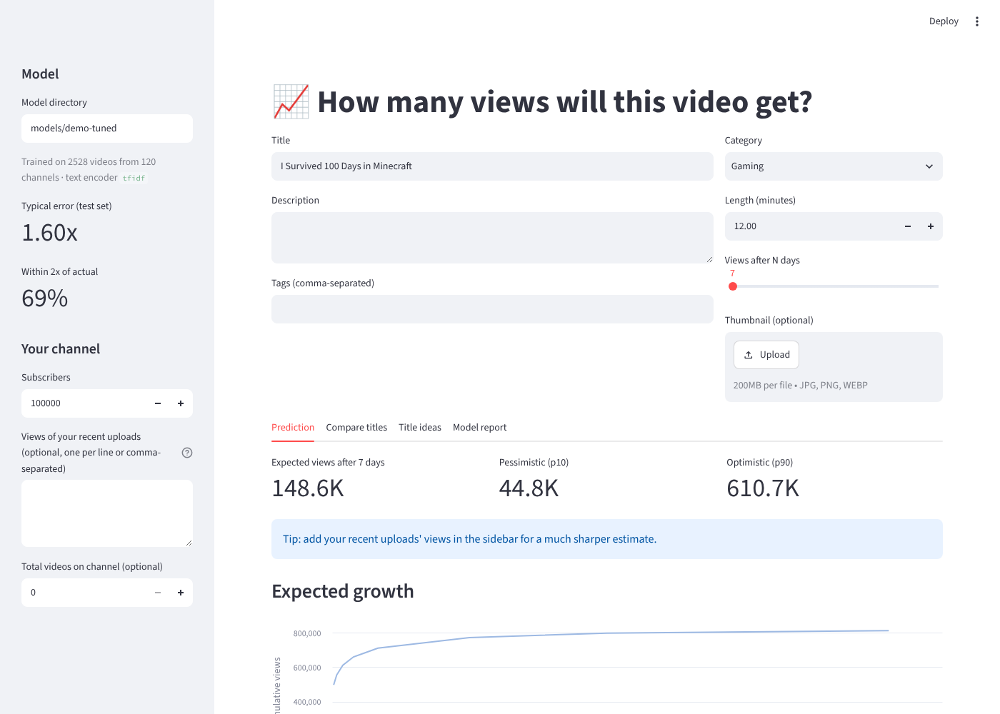
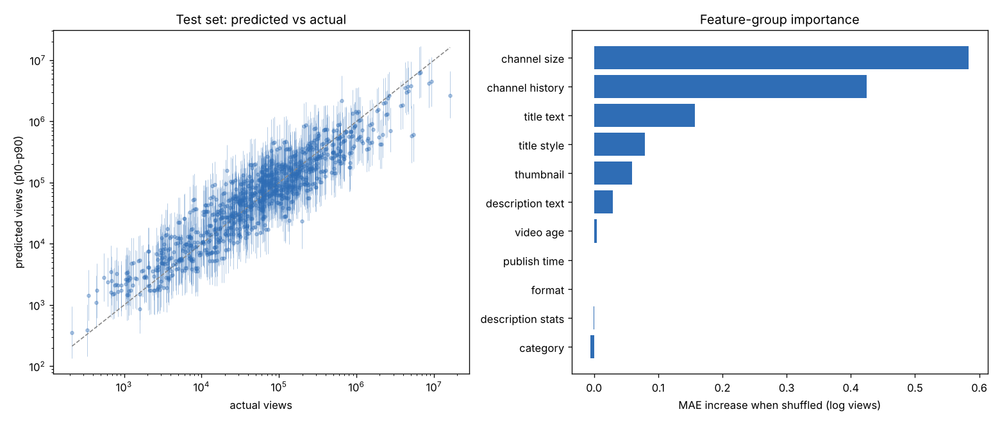

# YouTube Views Prediction Using Neural Networks — v2

[](https://github.com/morganwhite13/YouTube-Views-Prediction-Using-Neural-Networks/actions/workflows/ci.yml)
[](https://www.python.org/downloads/)
[](https://pytorch.org/)
[](LICENSE)

Predict how many views a YouTube video will get from things a creator knows **before
publishing**: title, description, tags, thumbnail, category, length, upload time and the
channel's size and recent track record. Instead of one number, you get a **range** (p10 / p50 /
p90). You also get:

* a **growth curve** (views after 1 day, 1 week, 1 year),
* an **explanation** of what pushes the prediction up or down ("your title ×0.4, your channel
  history ×1.8"),
* **title ideas** generated from your draft (optionally by Claude) and ranked by the model,
* a CLI, a web app, an HTTP API and a shareable HTML report.

> **Looking for the original project?** v1 (the COMP 3106 course project) is preserved unchanged
> in [`legacy/`](legacy/), including its README, docs and `projectFinal.py`. If you have the
> JSON datasets v1 produced, you can import them into v2 with `ytviews import-legacy`.



## What's new in v2

| | v1 (`legacy/projectFinal.py`) | v2 (`src/ytviews/`) |
|---|---|---|
| **Target** | raw view count, MSE loss | `log1p(views)`, quantile (pinball) loss → p10/p50/p90 |
| **Uncertainty** | none | quantile heads that can't cross + conformal calibration (≈80% of outcomes land in the p10–p90 band) |
| **Text** | `Embedding(100000, 300)` trained from scratch per field (~30M params each) on a few hundred videos | pretrained sentence-transformer embeddings (offline TF-IDF+SVD fallback) |
| **Video age** | `today − publishedAt` measured at *training* time, so cached data silently aged | age measured at the moment views were fetched; repeat fetches build growth curves |
| **Channel signal** | subscriber count | subscribers, channel size, and a *past-only* prior from the channel's earlier uploads (the strongest signal for creators) |
| **Network** | separate BiLSTMs over title / description / channel name / category id | wide & deep: per-input towers, channel context gates the text representation, residual fusion, monotone quantile head, seed ensemble |
| **Evaluation** | random split, tokenizer/scaler fit before splitting, no baselines | time / unseen-channel / random splits, everything fit on train only, compared against 4 baselines, permutation importance |
| **Data collection** | 2 API calls per video, `search.list` for uploads (100 units) | 50 videos per call, uploads playlist (1 unit), retries, quota budget, SQLite with snapshots |
| **Thumbnails** | not used | CLIP image embeddings, or offline image statistics (brightness, contrast, colourfulness, layout) |
| **Explanations** | none (README listed "SHAP/LIME" as future work) | exact Shapley values over feature groups for every prediction |
| **Tuning** | hand-picked constants | `ytviews tune`: random search on an inner validation split |
| **Usability** | edit the script, results printed | `ytviews` CLI, Streamlit app, FastAPI service + Dockerfile, HTML report, tests + CI |

There's also an offline `demo` command and a synthetic data generator, so the whole pipeline
runs without an API key.

## Quick start

```bash
git clone https://github.com/morganwhite13/YouTube-Views-Prediction-Using-Neural-Networks.git
cd YouTube-Views-Prediction-Using-Neural-Networks
python -m venv .venv && source .venv/bin/activate
pip install -e ".[all,dev]"        # or just `pip install -e .` for the core

# 1. See everything work offline on synthetic data (≈1 min on a laptop CPU)
ytviews demo

# 2. Explore it in the browser
YTVIEWS_MODEL=models/demo streamlit run app/streamlit_app.py
```

### With real YouTube data

```bash
cp .env.example .env               # then paste your YouTube Data API v3 key into .env

ytviews collect --seed-channels                     # v1's 23 channels, ~50 uploads each
ytviews collect --trending --region US --region GB  # trending videos + their back-catalogues
ytviews collect --query "minecraft" --query "cooking" --videos-per-channel 30
ytviews thumbnails                 # download thumbnails (no API quota)
ytviews stats

ytviews tune --trials 20           # optional: find good hyperparameters → best_config.json
ytviews train --config best_config.json   # train, evaluate vs baselines, save models/latest
ytviews report --html report.html  # shareable results page
ytviews refresh                    # later: re-fetch stats → growth-curve snapshots → retrain
```

The default daily API quota is 10,000 units. With batching, `collect --seed-channels` costs
roughly 50 units, and a `search` query costs 100. `--quota-budget` stops collection before you
hit the limit.

### Making predictions

```bash
ytviews predict --title "I Survived 100 Days in Minecraft" --category 20 \
    --subscribers 250000 --recent-views 180000,95000,240000,130000 --duration 900 \
    --thumbnail thumb.jpg

# or let it look up your channel's stats and recent uploads:
ytviews predict --title "I Survived 100 Days in Minecraft" --channel-id UCxxxxxxxxxxxx

ytviews compare "I Survived 100 Days in Minecraft" "Minecraft Hardcore Ep. 12" \
    "$1 vs $10,000 Minecraft Build" --subscribers 250000 --category 20   # which title?
ytviews explain --title "Minecraft Hardcore Ep. 12" --subscribers 250000 --category 20
ytviews suggest --title "Minecraft Hardcore Ep. 12" --subscribers 250000 --category 20 [--llm]
```

Output from the synthetic demo model (`ytviews demo`):

```text
"I Survived 100 Days in Minecraft" after 7 days:
  ~125.1K views
  80% range: 40.5K - 502.7K

Expected trajectory:
  day    1:  109.4K  (34.6K - 457.5K)
  day    7:  125.1K  (40.5K - 502.7K)
  day   30:  139.1K  (46.0K - 531.2K)
  day  365:  162.2K  (55.9K - 550.3K)

1.  236.4K  (100% of best)  $1 vs $10,000 Minecraft Build
2.  201.7K  ( 85% of best)  I Survived 100 Days in Minecraft
3.  105.7K  ( 45% of best)  Minecraft Hardcore Ep. 12

An average video after 7 days: ~48.1K views
  channel history    x1.71   ++++
  channel size       x1.51   +++
  title style        x1.12   +
  ...
This video: ~100.2K views
```

`suggest` rewrites your draft with common title patterns and, with `--llm`, also asks Claude
(`claude-opus-5-5`, needs `ANTHROPIC_API_KEY`) for ideas that stay true to the video. The model
then ranks every candidate. It can't judge whether a title is honest, so check the winner.

From Python:

```python
from ytviews.predictor import Predictor, VideoInput

p = Predictor.load("models/latest")
video = VideoInput(
    title="I Survived 100 Days in Minecraft",
    category_id="20",
    subscribers=250_000,
    recent_video_views=[180_000, 95_000, 240_000],
    thumbnail_path="thumb.jpg",
)
p.predict(video)  # [Prediction(low=..., median=..., high=..., coverage=0.8)]
p.trajectory(video)  # DataFrame: days → low / median / high
p.compare_titles(video, ["Title A", "Title B"])
p.explain(video).effects  # group, log_effect, factor
```

### HTTP API and Docker

```bash
ytviews serve --model models/latest          # http://127.0.0.1:8000/docs
curl -s localhost:8000/predict -H 'content-type: application/json' \
  -d '{"title": "I Survived 100 Days in Minecraft", "subscribers": 250000, "category_id": "20"}'

docker build -t ytviews .
docker run -p 8000:8000 -v "$PWD/models:/app/models" ytviews
```

Endpoints: `/predict`, `/compare`, `/explain`, `/suggest`, `/model`, `/health`. Thumbnails are
sent as `thumbnail_base64`.

## How it works

```
                 ┌──────────────── features (fit on training rows only) ────────────────┐
 title ─────────►│ sentence embedding (MiniLM, 384-d)  │ or TF-IDF word+char n-grams → SVD │
 description+tags│ sentence embedding                  │                                    │
 category ──────►│ learned embedding                                                       │
 channel ───────►│ log subscribers, channel size, avg views/video (excluding this video)    │
 past uploads ──►│ median / mean / max / spread of log views of the channel's last 10      │
 timing ────────►│ log age at fetch time, hour & weekday (cyclic)                          │
 format/style ──►│ duration, Shorts, captions, HD, title length/caps/emoji/"vs"/"$"/"?"... │
 thumbnail ─────►│ CLIP image embedding  │ or brightness/contrast/colour/layout statistics  │
                 └───────────────────────────────────────────────────────────────────────────┘
                                                   │
          ┌────────── deep ──────────┐             │            ┌─── wide ───┐
          │ text towers ─► × gate(channel context)│            │  linear on │
          │ numeric+category towers ─► concat ─► 2 residual blocks          │  all inputs│
          └───────────────────┬───────────────────┘            └─────┬──────┘
                              └──────────────► + ◄──────────────────┘
                                               ▼
                    monotone quantile head: p10 ≤ p50 ≤ p90  (of log1p views)
```

* **Gating:** the channel context scales the text representation, so the model can learn
  "this kind of title works for *this kind of channel*". This is a lighter version of v1's
  planned feature-interaction layer.
* **Missing-context augmentation:** during training, 30% of videos also appear with their
  channel history removed, and 15% without their thumbnail. That way the model still predicts
  well when you only know a subscriber count. These copies get a lower loss weight and are kept
  out of early stopping and calibration.
* **Explanations:** with ~10 feature groups, every on/off combination fits in one batch, so the
  Shapley values are exact. The baseline is an average video *of the same age*.
* **Ensemble + early stopping:** 5 networks trained on different validation splits are
  averaged. Their held-out errors set the conformal widening of the p10–p90 band.
* **Leakage guards:** likes and comments are never inputs, because they're outcomes. The
  channel prior uses only *earlier* uploads, and the channel's average excludes the video being
  predicted.

## Results

`ytviews train` writes `report.md`, `report.png`, `test_predictions.csv` and `meta.json` next to
the model, and `ytviews report --html` turns them into a shareable page. The table below uses
**synthetic data** (`ytviews synth`, time-based split), so it shows the machinery working, not
real-world accuracy. Run `ytviews train` on collected data for real numbers.

| model | MAE (log) | R² (log) | median factor error | within 2× | p10–p90 coverage |
|---|---|---|---|---|---|
| **neural net, tuned** | **0.559** | **0.861** | 1.60× | **69%** | 82% |
| neural net, default settings | 0.594 | 0.838 | 1.61× | 67% | 78% |
| LightGBM (all features) | 0.577 | 0.838 | 1.56× | 67% | – |
| ridge (all features) | 0.589 | 0.842 | 1.61× | 66% | – |
| channel heuristic | 0.736 | 0.744 | 1.83× | 56% | – |
| global median | 1.522 | −0.101 | 3.30× | 31% | – |

*Median factor error 1.6× = the typical prediction is within ~1.6× of the true view count.*

With default settings (and the demo's 2-network ensemble) the network is level with the
baselines. `ytviews tune` (16 trials, scored on an inner validation split that never touches
the test set) plus a 5-network ensemble puts it ahead. On real data, compare it against
LightGBM yourself: the baselines are in every report for that reason.



On the synthetic data the network recovers what was planted: channel size first, then channel
history, then title wording and thumbnail design. For comparison, v1 reported a log-scale MAE
of 1.73 on 552 videos, with a random split and no baseline. That number isn't comparable to the
table above (different data and split), but `ytviews train --split random` reproduces v1's
setup if you want a like-for-like run.

## Commands

| command | what it does |
|---|---|
| `ytviews collect` | `--channel ID`, `--seed-channels`, `--trending [--region]`, `--query TEXT` |
| `ytviews refresh` | re-fetch stats for every stored video (adds snapshots) |
| `ytviews import-legacy FILE...` | import v1 JSON caches |
| `ytviews thumbnails` | download thumbnails for stored videos (no quota) |
| `ytviews stats` | dataset summary |
| `ytviews tune` | hyperparameter search → `best_config.json` |
| `ytviews train` | `--split time\|channel\|random`, `--encoder auto\|sbert\|tfidf`, `--image-encoder auto\|clip\|stats\|none`, `--config` |
| `ytviews predict` / `compare` | single prediction + trajectory / rank candidate titles |
| `ytviews explain` | what pushes a prediction up or down |
| `ytviews suggest` | generate and rank title ideas (`--llm` adds Claude's) |
| `ytviews serve` | HTTP API |
| `ytviews report` | print the saved evaluation report, or `--html FILE` for a web page |
| `ytviews synth` / `demo` | synthetic dataset / full offline run |

## Project layout

```
src/ytviews/
  youtube.py     quota-aware YouTube Data API client (batching, retries, parsing)
  collect.py     collection strategies (channels, trending, search, refresh)
  store.py       SQLite storage with per-fetch snapshots; v1 JSON import
  features.py    feature engineering, past-only channel history, FeatureBuilder
  text.py        sentence-transformer / TF-IDF+SVD text encoders
  images.py      CLIP / image-statistics thumbnail encoders
  model.py       ViewsNet (wide & deep, gated fusion, monotone quantile head)
  train.py       ensemble training, early stopping, conformal calibration
  baselines.py   global median, channel heuristic, ridge, LightGBM
  evaluate.py    splits, metrics, permutation importance
  pipeline.py    train → evaluate → report → save
  predictor.py   load a model; predict / compare titles / trajectory
  explain.py     exact group-Shapley explanations
  suggest.py     rule-based + Claude title ideas, ranked by the model
  tune.py        hyperparameter search
  api.py         FastAPI service
  report_html.py shareable HTML report
  synthetic.py   synthetic data with a known generating process
  cli.py         `ytviews` command
app/streamlit_app.py   web UI
Dockerfile             API image (also runs the web UI)
tests/                 offline test-suite (fake API, synthetic data)
legacy/                the original v1 project, untouched
```

## Development

```bash
pip install -e ".[dev,gbm,app,api,llm]"
pytest            # ~40 s, fully offline (the Claude API and YouTube API are faked)
ruff check . && ruff format --check .
```

## Limitations and next steps

* **Selection bias:** API sampling over-represents active, discoverable channels. Use
  `--split channel` for a more pessimistic estimate of performance on new creators.
* **Snapshot timing:** subscriber counts and the channel prior are measured at fetch time,
  not at the moment each historical video was published.
* **Not yet run on real data in this repo:** the numbers above are synthetic. Pretrained
  encoders (sentence-transformers, CLIP) are wired in and tested with stand-ins, but the
  bundled results use the offline fallbacks.
* **Ideas:** fine-tuning the text encoder end to end, per-category growth curves from repeated
  `refresh` snapshots, thumbnail text (OCR) features.

## License & acknowledgements

MIT — see [LICENSE](LICENSE). Built on the YouTube Data API v3, PyTorch, scikit-learn,
sentence-transformers, LightGBM and Streamlit. Original v1 by
[Morgan White](https://github.com/morganwhite13).
